# Bill Cipher & Friends — Desktop Companion

<p align="center">
  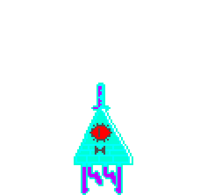
  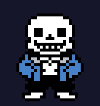
  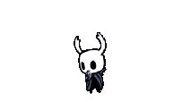
  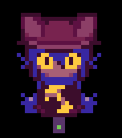
</p>
<p align="center">
  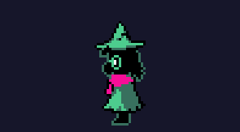
  
  
</p>

<h3 align="center">Bill Cipher lives on your desktop — and he brought friends.</h3>

<p align="center">Seventeen companions across five games. They study your apps, watch the sky, press buttons they shouldn't, roam the screen, and chat back through their own pixel speech bubbles.</p>

<p align="center">
  <a href="https://github.com/Jasonilization/bill-cipher-companion/releases/latest"><b>Download the DMG</b></a> · <a href="https://jasonilization.github.io/bill-cipher-companion/">Homepage</a> · <a href="https://jasonilization.github.io/bill-cipher-companion/animations.html">Every animation, looping</a></p>

<p align="center">
  <a href="https://github.com/Jasonilization/bill-cipher-companion/releases/latest"></a>
  <a href="https://github.com/Jasonilization/bill-cipher-companion/releases"></a>
  <a href="https://github.com/Jasonilization/bill-cipher-companion/actions"></a>
  <a href="LICENSE"></a>
</p>

---

Native Swift end to end (AppKit + SpriteKit + WebKit): a hand-drawn **380-sprite Bill rig** plus a data-driven **pack system** that turns hand-labeled sprite sheets into fully animated characters — each with its own dialogue voice, ChatGPT persona, roaming style, and speech-bubble theme.

> *Unofficial, non-commercial fan project. Bill Cipher and Gravity Falls are © Disney. Undertale © Toby Fox, Deltarune © Toby Fox, OneShot © Eliza Velasquez & Nightcat Studios, Hollow Knight © Team Cherry. Not affiliated with or endorsed by any of them.*

## The roster

| Gravity Falls | Undertale | Deltarune | OneShot | Hollow Knight |
|---|---|---|---|---|
| Bill Cipher | Sans, Sans (Battle), Papyrus, Toriel, Frisk, Flowey (stays planted), Temmie, Monster Kid, Annoying Dog | Kris, Ralsei, Susie — with light/dark world modes and a crossfade between them | Niko | The Knight, Hornet, Weaver |

Seventeen companions now, switchable live from the menu bar or Settings. Companions ride along in the same window, wander on their own, banter, and bump.

<p>
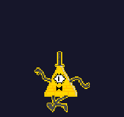&nbsp;
&nbsp;
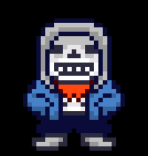&nbsp;
&nbsp;
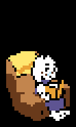&nbsp;
&nbsp;
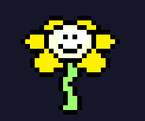&nbsp;
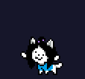&nbsp;
&nbsp;
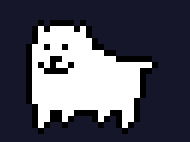
<br>
&nbsp;
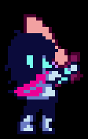&nbsp;
&nbsp;
&nbsp;
&nbsp;
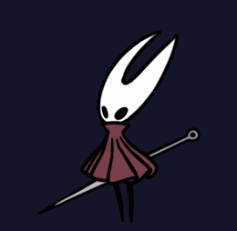&nbsp;
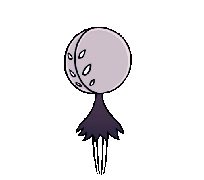
</p>

> ⚠️ **The sprite packs are a work in progress.** They're hand-labeled and actively being refined — backgrounds, scales, walk directions, more characters. Expect changes.

## What they do

- **Roam the desktop.** Four-direction characters (Frisk, Sans, Toriel, Kris, Ralsei, Susie, Niko) stroll the whole screen top-down — up is up, down is down. The Knight and Hornet keep full platformer physics: jumping between windows, wall slides, climbing. Flowey stays planted, because flower.
- **React to what you do.** App launches, incognito windows, trash, clipboard, screenshots, the weather, the time of day — each has in-character reactions per character.
- **Push windows aside.** (Opt-in, Behaviour settings.) Walking across an app window nudges it a few points over — never the app you're actively using, and it stops the instant you drag it yourself.
- **Talk back.** Right-click → Talk opens a pixel speech bubble wired to a real ChatGPT session — no API key. Every character has its own persona (sans types lowercase, Papyrus is VERY LOUD, the Knight speaks in lore tablets).
- **Keep you company.** Idle beats, showcase performances of the whole sprite sheet, banter between companions, per-character dialogue pools for time of day and context.

## Make them yours

Settings covers character selection and companions, per-trigger animation assignment, per-family Facing (left / right-mirror) and World (light/dark) labels, live animated previews of every sheet, idle pacing, speech frequency, roaming and mischief toggles, bubble themes, and more.

## Requirements

- **macOS 14+** for the native app (the primary experience)
- **Windows 10/11 or Linux (X11)** via the Electron port in [`desktop/`](desktop/) — see below
- Permissions are all optional and each powers a specific feature: Accessibility (window awareness, mischief, pushing), Screen Recording (reading window titles), Location (weather)

## Install (Mac)

Grab the **DMG** from the [latest release](https://github.com/Jasonilization/bill-cipher-companion/releases/latest), drag Bill to Applications, launch, and grant whatever permissions you want.

> Ad-hoc signing caveat: macOS drops Accessibility/Screen Recording permissions on every new build — re-grant after updating.

## Windows and Linux

Two ports ship in this repo:

- **Electron port** ([`desktop/`](desktop/)) — runs on Windows 10/11 and Linux (X11), reusing the same sprites and dialogue. Keeps the roaming physics, barks, ChatGPT chat (cookie-based, no API key), weather, study mode, personalization and settings. Adds Troll/Helpful modes, solve-on-screen (`Ctrl+Alt+S`, on-machine math solver) and Brawl (`Ctrl+Alt+F`).
  - **Status:** 53/53 logic checks pass; the app self-test passes on Windows 11. The Linux run, brawl, and packaged installers have not been tested yet — build with `npm run dist:win` / `dist:linux`.
  - Run from source: `cd desktop && npm install && npm start`
- **WPF Windows preview** ([`windows/`](windows/)) — the earlier C# port; builds with `dotnet publish`.

## Build from source (Mac)

```sh
git clone https://github.com/Jasonilization/bill-cipher-companion.git
cd bill-cipher-companion
swift build                              # zero errors expected
swift Scripts/validate_sprite_assets.swift   # 4,000+ sprite-data checks, must exit 0
```

Bundle assembly is manual (see `.opencode/skills/swift-appkit-spritekit/SKILL.md`): copy `.build/debug/Bill`, `Resources/Info.plist`, `Resources/AppIcon.icns` and every `.build/debug/*.bundle` into `Bill.app/Contents/…`, then `codesign --force --sign -`.

## How it's put together

- **`Sources/Bill/Animation`** — the state space, clip system, state machine, Bill's 68-family clip table
- **`Sources/Bill/Packs`** — the character system: roster, lazy sprite catalogs, the state→family resolver (workbench-label aware), companions, dialogue voices
- **`Sources/Bill/CharacterEngine`** — ambient beats, rare events, the reaction router, per-character dialogue
- **`Sources/Bill/Roaming`** — the physics sim, the roaming controller (platformer + top-down modes), window topology, the window pusher
- **`Sources/Bill/UI`** — the borderless SpriteKit window, chat, Settings
- **`Scripts/rebuild_from_workbench.py`** — the sprite pipeline: builds everything from the hand-labeled `build-assets/workbench_export.json`; the manifest and roster geometry are derived, never hand-edited

## More indie games to come

The pack system is built for it: any hand-labeled sprite sheet becomes a playable pack with its own animations, dialogue voice, and bubble theme. More indie favorites are on the way — this roster is just the beginning.

## License

Code is released under the [MIT License](LICENSE). Bill Cipher and all Gravity Falls references belong to Disney. The pixel sprites are used for this non-commercial fan project with credit to their creators:

- Bill Cipher — artwork by [Kelly Nora](https://kiernenking.newgrounds.com/) (@kiernenking); sheet by JayHyperStarX
- Undertale / Deltarune — ripped by asym & collaborators, The Spriters Resource
- OneShot — ripped by accuratejaney, The Spriters Resource
- Hollow Knight — community rips, The Spriters Resource
